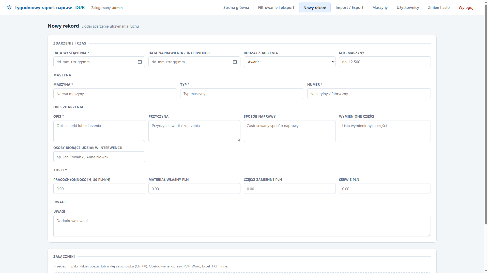
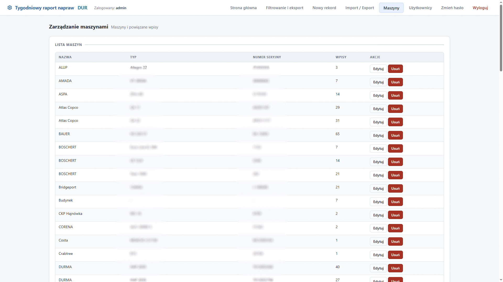
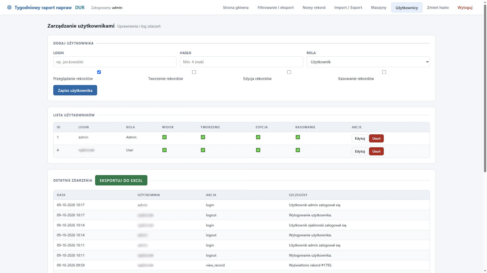

# Tygodniowy-raport-zdarzen

Przeglądarkowa aplikacja Flask do prowadzenia tygodniowego raportu napraw dla działu utrzymania ruchu.

## Spis tresci

- [Tygodniowy-raport-zdarzen](#tygodniowy-raport-zdarzen)
  - [Spis tresci](#spis-tresci)
  - [Uruchomienie](#uruchomienie)
  - [Konfiguracja](#konfiguracja)
  - [Dostępne funkcje](#dostępne-funkcje)
  - [Przykładowy wygląd aplikacji](#przykładowy-wygląd-aplikacji)
    - [Strona główna](#strona-główna)
    - [Filtrowanie i eksport](#filtrowanie-i-eksport)
    - [Nowy rekord](#nowy-rekord)
    - [Import / Export](#import--export)
    - [Logowanie i zmiana hasła](#logowanie-i-zmiana-hasła)
    - [Panel maszyn](#panel-maszyn)
    - [Panel użytkowników](#panel-użytkowników)
  - [Testy](#testy)


## Uruchomienie

```bash
python -m venv .venv
# Linux/macOS:
source .venv/bin/activate
# Windows PowerShell:
# .\.venv\Scripts\Activate.ps1
pip install -r requirements.txt
flask --app app:create_app run --host 0.0.0.0 --port 5001
```

Aplikacja używa bazy SQLite tworzonej automatycznie w katalogu `instance/`.

Po uruchomieniu jest dostępna lokalnie pod `http://localhost:5001/` oraz z
innych komputerów w sieci pod `http://ADRES_IP_SERWERA:5001/`. Aby uruchomić
ją bezpośrednio, można także użyć `python app.py`; ten tryb również nasłuchuje
na porcie `5001` i wszystkich interfejsach sieciowych.

Na serwerze należy zezwolić w zaporze systemowej na przychodzące połączenia TCP
na porcie `5001`. W Zaporze systemu Windows można to zrobić z poziomu
„Reguły przychodzące” przez dodanie reguły dla portu TCP `5001`.
## Konfiguracja

Aplikacja obsługuje plik `config.json` do elastycznego konfigurowania:

- **DATABASE** - ścieżka do bazy danych (obsługuje dyski sieciowe UNC/NFS)
- **UPLOAD_DIR** - katalog dla przesyłanych plików
- **PORT** - port nasłuchiwania
- **HOST** - adres IP nasłuchiwania
- **DEBUG** - tryb debugowania
- **LABOR_RATE_PLN_PER_HOUR** - stawka godzinowa dla obliczeń
- **MAX_UPLOAD_SIZE_MB** - maksymalny rozmiar pliku
- **REQUIRE_LOGIN** - czy logowanie jest wymagane

**Przykład dla dysku sieciowego (Windows UNC):**
```json
{
  "DATABASE": "//nas-server/share/repair_reports.sqlite3",
  "UPLOAD_DIR": "//nas-server/share/uploads"
}
```

**Przykład dla Linux (NFS):**
```json
{
  "DATABASE": "/mnt/nas/repair_reports.sqlite3",
  "UPLOAD_DIR": "/mnt/nas/uploads"
}
```

Pełna dokumentacja: [CONFIG.md](CONFIG.md), [CONFIG_EXAMPLES.md](CONFIG_EXAMPLES.md), [NETWORK_STORAGE.md](NETWORK_STORAGE.md)
## Dostępne funkcje

- wpisywanie rekordów napraw i interwencji,
- automatyczne wyliczanie roku, tygodnia, pozycji w tygodniu, czasu wykluczenia z produkcji i kosztu łącznego,
- filtrowanie rekordów po maszynie, rodzaju zdarzenia, zakresie dat i słowach z opisu,
- podgląd poprzednich wpisów dla wybranej maszyny,
- import danych z plików `.xls` i `.xlsx`,
- eksport przefiltrowanych danych lub całej bazy do `.xlsx`,
- logowanie użytkowników i administratorów,
- zarządzanie uprawnieniami do przeglądania, tworzenia, edycji i usuwania rekordów,
- administracyjne zarządzanie danymi maszyn i ich wpisami.

## Przykładowy wygląd aplikacji

Poniższe zrzuty ekranu pokazują przykładowy widok rejestru oraz filtrowanie
rekordów. Zawierają wyłącznie fikcyjne dane demonstracyjne.

### Strona główna


Strona główna (`/`) pokazuje rejestr ostatnich zdarzeń: datę, maszynę, rodzaj
zdarzenia, opis, przyczynę, sposób naprawy i informację o załącznikach. Można
zmienić liczbę wyświetlanych wpisów lub pokazać wszystkie. Kliknięcie wiersza
otwiera szczegóły rekordu; zależnie od uprawnień można go edytować lub usunąć,
a także pobrać jego raport PDF i załączniki.

### Filtrowanie i eksport


Na stronie **Filtrowanie** (`/filter`) można zawęzić rejestr według nazwy,
typu lub numeru seryjnego maszyny, rodzaju zdarzenia, zakresu dat oraz słów
w opisie, przyczynie, naprawie, wymienionych częściach i uwagach. Wiele słów
można rozdzielić średnikiem. Użytkownicy inni niż goście mogą pobrać wyniki
filtrowania do pliku `.xlsx`.

### Nowy rekord



Formularz **Nowy rekord** (`/new`) służy do zapisania zdarzenia utrzymania ruchu.
Zawiera daty wystąpienia i naprawy, dane maszyny, rodzaj zdarzenia, opis,
przyczynę, sposób naprawy, części, uczestników, koszty i uwagi. Można także
dodać załączniki, między innymi przez przeciągnięcie plików, wybór z dysku lub
wklejenie ze schowka. Podczas uzupełniania danych maszyny formularz może
wyświetlić historię jej wcześniejszych wpisów. Rok, tydzień, kolejność wpisu,
czas przestoju i koszt łączny są wyliczane automatycznie.

### Import / Export

Strona **Import / Export** jest dostępna pod adresem `/data`. Pozwala importować
dane z plików Excel `.xls` i `.xlsx`. Aplikacja szuka arkusza `ZBIORCZE`; jeśli
go nie znajdzie, używa pierwszego arkusza. Kolumny są dopasowywane automatycznie,
a importowane dane nie usuwają istniejących rekordów. Import jest dostępny dla
administratora oraz użytkownika z uprawnieniem do tworzenia rekordów.

Użytkownicy inni niż gość mogą pobrać eksport całej bazy jako plik `.xlsx`.
Plik zawiera arkusz `ZBIORCZE` z kolumnami w układzie raportu tygodniowego.

### Logowanie i zmiana hasła

Strona logowania (`/login`) umożliwia wejście na konto użytkownika lub
administratora. Pozostawienie loginu i hasła pustych otwiera dostęp gościa
wyłącznie do odczytu. Zalogowany użytkownik może otworzyć **Zmień hasło**
(`/change-password`), podać obecne hasło i ustawić nowe o długości co najmniej
4 znaków.

### Panel maszyn



Po zalogowaniu jako administrator wybierz w menu aplikacji pozycję **Maszyny**
lub otwórz adres `/admin/machines`. Panel wyświetla nazwę, typ, numer seryjny
każdej maszyny oraz liczbę powiązanych z nią wpisów.

Administrator może edytować nazwę, typ i numer seryjny. Zmiana dotyczy wszystkich
wpisów przypisanych do tej maszyny. Numer seryjny musi być unikalny; zapis nie
powiedzie się, jeśli jest już używany przez inną maszynę.

Usunięcie maszyny usuwa również wszystkie jej wpisy i załączone pliki. Przed
operacją aplikacja pokazuje liczbę wpisów do usunięcia i prosi o potwierdzenie.
Usunięcia nie można cofnąć.

### Panel użytkowników



Administrator może otworzyć panel użytkowników pod adresem `/admin/users` i zarządzać kontami bezpośrednio z poziomu aplikacji.

Panel umożliwia:

- tworzenie nowych kont użytkowników,
- edycję istniejących kont i ich uprawnień,
- zmianę roli użytkownika na użytkownika lub administratora,
- zmianę hasła użytkownika,
- nadawanie niezależnych uprawnień do przeglądania, tworzenia, edycji i usuwania rekordów,
- usuwanie kont użytkowników.

W panelu znajduje się również dziennik aktywności. Rejestrowane są między innymi logowania i wylogowania, zmiany haseł, operacje na rekordach i załącznikach, import i eksport danych oraz zarządzanie kontami. Dziennik wyświetla 20 zdarzeń na stronie i posiada paginację.

Administrator ma pełne uprawnienia niezależnie od ustawień poszczególnych pól. Zwykły użytkownik może wykonywać tylko operacje wynikające z przyznanych mu uprawnień.

## Testy

```bash
python -m unittest discover -s tests
```